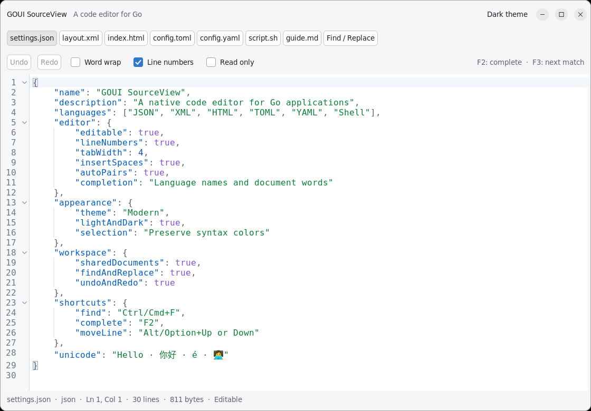
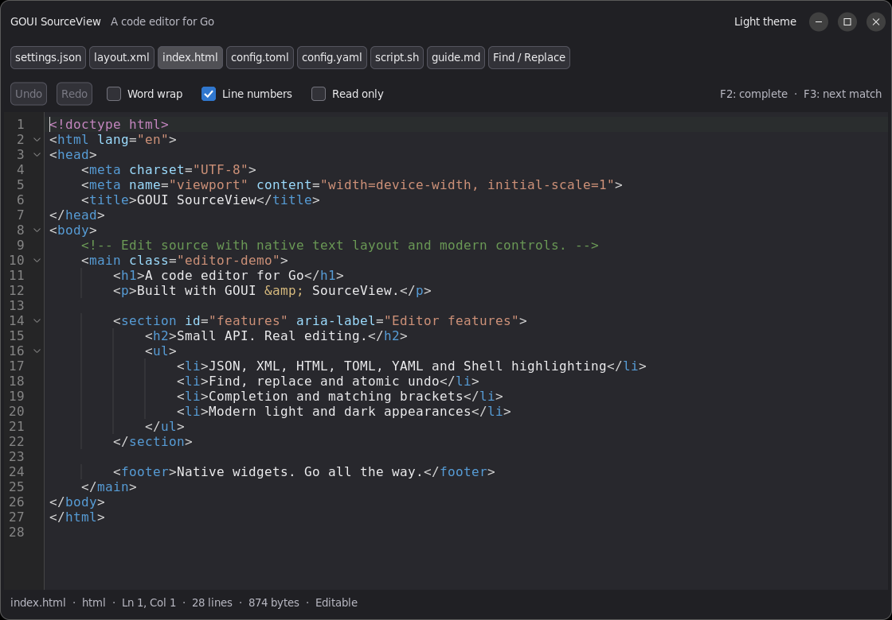

<h1 align="center">GOUI SourceView</h1>

<p align="center">A native code editor for Go applications</p>

<p align="center"><a href="doc/README_CN.md">中文</a></p>

GOUI SourceView brings source code editing to [GOUI](https://github.com/golang-gui/goui)
applications, with syntax highlighting, completion, matching brackets, and Modern
light/dark appearances. It supports both imperative and declarative integration.

The project is under active development.

## Features

- **Syntax highlighting** for JSON, XML and HTML.
- **Code editing** with Unicode selection, clipboard, undo/redo, indentation and line operations.
- **Completion and brackets** with suggestions, automatic pairs and matching-bracket navigation.
- **Find and replace** in a floating panel, with case-sensitive and whole-word search options.
- **Light and dark appearances** with syntax colors preserved in selections.
- **Multilingual controls** with editor menus and find/replace available in eight languages.

## Screenshots

Modern Light — JSON



Modern Dark — HTML with find and replace



Screenshots from the example running on Linux.

## Try the example

Requires Go 1.24 or newer. Follow the [example guide](example/README.md) to prepare
the development environment, then run from the repository root:

```sh
go run ./example/editor
```

The example lets you edit JSON, XML and HTML, try search and completion, and switch
between light and dark appearances. A [declarative example](example/declarative) is also available.

## Documentation

- [Example guide](example/README.md)
- [Imperative example](example/editor/main.go) · [Declarative example](example/declarative/main.go)
- [Development documentation](doc/DesignSourceView.md) · [Roadmap](doc/Roadmap.md)
