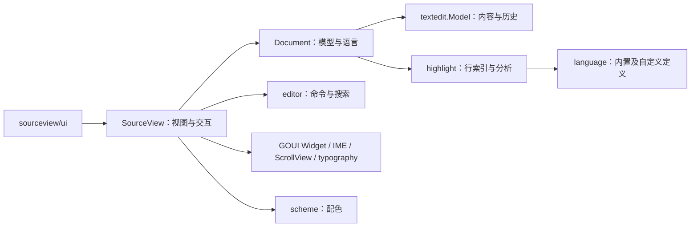

# SourceView 代码编辑器设计

> 状态：首版设计契约，已有初始实现。本文及专题中的范围不代表全部实现或平台验收完成；实际能力与结果见 [实现记录](Plan.md)。
> 本项目是独立代码编辑器，不以 `gui.TextView` 或私有 `textEditor` 为基础。

## 1. 定位、范围与阅读顺序

模块路径为 `github.com/golang-gui/goui-sourceview`。作为 GOUI 的可选扩展，
本仓库负责代码编辑行为、语言、高亮、配色和源码呈现，独立发布；
GOUI 不反向依赖本模块。

首版交付可编辑的单光标代码控件：IME、导航与选择、剪切复制粘贴、删除、撤销重做、
基础缩进、字面量查找替换、行号、滚动、配色及 **JSON、XML、HTML 三种语言高亮**。
只读是可选模式。基础补全和括号交互见 [补全设计](DesignCompletion.md) 与 [括号设计](DesignPairs.md)。
查找、替换和定位作为 SourceView 的[内置配套界面](DesignFindBar.md)，固定在视口右上角；
控件和输入框使用所属 GUI 样式环境，裸控件只提供操作与高亮能力。
多光标、折叠、语义补全、完整嵌入语言等后续能力见 [Roadmap](Roadmap.md)。

| 阅读顺序 | 文档 | 负责的问题 |
| --- | --- | --- |
| 1 | 本文 | 组成、公共 API、所有权、默认值及固定决策 |
| 2 | [GOUI 接入与扩展](DesignGOUIIntegration.md) | 已有公开能力、真实缺口、跨仓扩展契约 |
| 3 | [编辑核心](DesignEditing.md) | 命令、历史、选区、IME、剪贴板、查找替换 |
| 4 | [语言与高亮](DesignHighlighting.md) | 扫描器、内置及自定义语言、行缓存、增量传播与调度 |
| 5 | [布局与呈现](DesignLayout.md) | 视口、行号、Tab、排版、装饰与资源 |
| 6 | [测试约定与验收](Testing.md) | 样本、断言、规模、平台矩阵与性能目标 |
| 7 | [开发计划](Plan.md) | 切片顺序、前置依赖、产物及退出条件 |

长期原则仍在 [AGENTS.md](../AGENTS.md)。具体实现不能只阅读某个 API 列表而跳过其专题契约。

## 2. 固定决策

1. SourceView 独立实现 Widget、输入行为和排版缓存，复用 GOUI 的框架设施。
2. 复用 `gui/textedit.Model` 作为首版文本及历史基础，优先复用 Projection、Geometry、HeightIndex；不复制 Piece Tree 或私有编辑器。
3. 以 Document 组合模型、语言和共享分析；选区、预编辑、视口、查找、配色及原生布局属于每个视图。
4. SourceView 实现 `Scrollable`，自行绘制正文并拥有内部配套子控件。外部组合 GOUI ScrollView 提供滚动条；宿主显式使用 `source-view` 样式，统一绘制包含滚动条的外框；行号与正文由同一控件呈现。
5. 首版语言使用自行编写的纯 Go、有状态、可分段扫描器。暂不引入原生编辑器、WebView、Tree-sitter、完整 Monarch 或 TextMate 运行时。
6. 首版在 GUI 线程按预算推进分析；先不引入后台 goroutine、模型快照协议或多线程排版。
7. 首版 token 样式只改变前景色。字号、字重和斜体等按 token 改变度量的能力后续单独设计。
8. 批量编辑与历史选区、可配置 Tab 排版、剪贴板错误反馈的通用缺口单独提案；不要求扩展 TextView。

自有扫描器让各语言的状态、取消边界和错误恢复可控。它不承担完整语义解析，
也不承诺读取其他编辑器的语言规则格式；应用可实现公开 Tokenizer 适配其他引擎，
绑定及编辑配置见 [语言扩展](DesignLanguageExtensions.md)。

## 3. 包与依赖

以下是开发落位，不要求立即创建全部空目录：

| 包或目录 | 首版职责 |
| --- | --- |
| 根包 `sourceview` | Document、SourceView、内部配套界面、公共编辑与查找 API、信号 |
| `language` | 不可变语言定义、扫描协议、内置扫描器与编辑规则；不导入 gui |
| `scheme` | 不可变代码配色与 token 颜色；不导入 gui |
| `internal/editor` | 命令计划、缩进、位置映射、字面量搜索；不导入 gui |
| `internal/highlight` | 行元数据、增量调度与高亮缓存；不导入 gui |
| `ui` | GOUI WidgetView 绑定，不直接导入 platform |
| `example/`、`tests/window/`、`testdata/` | 使用示例、显式窗口验证及固定样本 |

`sourceview` 可以使用 GOUI 的 gui、core、layout、typography、graphics 公开能力；
FindBar 还复用 GOUI widgets.CheckButton，不反向引入框架依赖。
算法包可消费 typography 度量类型，不创建原生 Context 或 TextLayout。
不将每个内部结构都提升为独立包，不导出行缓存、布局缓存或调度器。

根包内按职责组织文件，不以文件拆分新增包或公共接口：

| 文件 | 职责 |
| --- | --- |
| `sourceview.go` | 控件状态、配置、选区、语义快照、挂载、卸载及模型变化 |
| `document.go` | 文档、语言定义及共享分析状态 |
| `commands.go`、`search.go` | 编辑命令、历史、剪贴板与注释切换；查找替换、范围与高亮显隐 |
| `input.go`、`key_bindings.go` | 指针与键盘输入；快捷键配置、匹配及命令分发 |
| `layout.go`、`layout_cache.go`、`paint.go` | 视口布局、可见行映射、命中及滚动定位；段落缓存与着色；正文和装饰绘制 |
| `companions.go` | 内置查找／替换／定位的公开操作、互斥、视口布局和指针规则 |
| `scheduler.go` | 帧回调、分析计时器及可见区域排版工作 |
| `styles.go` | Basic/Modern 注册、有效样式、控件配色及样式变化处理 |

补全、折叠、语言编辑辅助及 FindBar/GoToBar 仍按已有领域组织。
同一领域的队列、绘制辅助或小控件合入所属功能文件；独立类型不要求独立文件。
补全保留会话和列表两个实现文件，面板与滚动组合在列表文件内；
FindBar 保留行为和外观两个文件；折叠及普通编辑辅助各自集中维护。
声明式层只绑定 SourceView，不单独声明查找或定位栏。
SourceView 的字段按文档与挂载、选区、原生资源、外观、布局、编辑辅助、
输入、搜索和补全分组；分组不引入额外状态对象，也不改变资源所有者。



## 4. 对象与所有权

| 对象 | 拥有 | 不拥有 |
| --- | --- | --- |
| Document | 模型引用、不可变语言定义、语言 ID/epoch、共享行元数据和 token 缓存 | 活动光标、视口、原生对象、文件路径 |
| SourceView | Document 引用、EditSource、选区与视觉 affinity、预编辑、搜索、布局缓存、挂载期订阅 | 其他视图状态、模型历史栈、Application |
| 内部配套栏 | 输入与按钮子树、替换文字、分块计数、挂载期连接；由 SourceView 拥有 | Document、历史 |
| ScrollView | 滚动偏移、滚动条与视口裁剪 | 文档和代码编辑策略 |
| Scheme | 复制后的不可变颜色表与版本身份 | Widget、系统订阅、原生资源 |
| 挂载期 Document 连接 | 一个模型订阅、已挂载视图登记、分析驱动者 | 脱离视图后仍无限运行的任务 |

Document 本身只有 Go 数据，不要求 Destroy。首个视图挂载时连接模型，最后一个视图
卸载时断开并释放分析工作缓存；无挂载视图期间可直接操作模型，下次挂载按修订重新建索引。
应用长期监听内容直接使用 `Document.Model().ConnectChange`，自行管理 handle。

SourceView 构造时不创建原生资源，不建立从外部模型指向控件的订阅。
卸载释放所有模型/根/计时器订阅、布局与预编辑；同一控件允许重新挂载。
未挂载期间模型没有变化则保留选区；修订变化而无法重放中间编辑时，将选区复位到 0，
不猜测映射。已销毁控件不能重新激活。

多个 Document 可以包装同一个 Model，各自选择语言与分析；共享分析只在共享同一个
Document 时发生，不建设全局 Model 注册表。

## 5. 公共 API 草案

以下声明位于根包；省略实现和普通配置 getter，不省略语义约束。
这里的类型和方法是本项目计划 API；GOUI 扩展另外列在对应专题。

```go
package sourceview

import (
    "github.com/golang-gui/goui/core/geometry"
    "github.com/golang-gui/goui/core/signal"
    "github.com/golang-gui/goui/gui"
    "github.com/golang-gui/goui/gui/textedit"
    "github.com/golang-gui/goui/platform/typography"
    "github.com/golang-gui/goui-sourceview/language"
    "github.com/golang-gui/goui-sourceview/scheme"
)

type Document struct { /* private */ }
func NewDocument(text string) *Document
func NewDocumentWithModel(model *textedit.Model) *Document
func (d *Document) ID() uint64
func (d *Document) Model() *textedit.Model
func (d *Document) Language() language.ID
func (d *Document) SetLanguage(id language.ID) error
func (d *Document) LanguageDefinition() *language.Language
func (d *Document) SetLanguageDefinition(l *language.Language)

type WrapMode = typography.WrapMode
const (
    WrapNone = typography.WrapNone
    WrapChar = typography.WrapChar
    WrapWordChar = typography.WrapWordChar
)

type SourceView struct {
    gui.WidgetBase
    // private
}
func NewSourceView() *SourceView
func (v *SourceView) Document() *Document
func (v *SourceView) SetDocument(document *Document)
func (v *SourceView) Selection() textedit.Selection
func (v *SourceView) SetSelection(selection textedit.Selection)
func (v *SourceView) ReadOnly() bool
func (v *SourceView) SetReadOnly(value bool)
func (v *SourceView) AcceptsTab() bool
func (v *SourceView) SetAcceptsTab(value bool)
func (v *SourceView) SetIndentOptions(options IndentOptions) error
func (v *SourceView) SetWrapMode(mode WrapMode)
func (v *SourceView) SetShowLineNumbers(value bool)
func (v *SourceView) SetScheme(value *scheme.Scheme)
func (v *SourceView) ReplaceSelection(text string) error
func (v *SourceView) ApplyEdits(d *Document, revision uint64, edits []textedit.Edit, after textedit.Selection) error
func (v *SourceView) MoveLines(down bool) error
func (v *SourceView) DuplicateLines(down bool) error
func (v *SourceView) DeleteLines() error
func (v *SourceView) Undo() bool
func (v *SourceView) Redo() bool
func (v *SourceView) Copy() error
func (v *SourceView) Cut() error
func (v *SourceView) Paste() error
func (v *SourceView) SetSearch(query SearchQuery)
func (v *SourceView) FindNext(backward bool) (textedit.Range, bool)
func (v *SourceView) ReplaceCurrent(text string) (bool, error)
func (v *SourceView) ReplaceAll(text string) (int, error)
func (v *SourceView) ShowFind() error
func (v *SourceView) ShowReplace() error
func (v *SourceView) ShowGoTo() error
func (v *SourceView) HidePanel()
func (v *SourceView) RevealSelection()
func (v *SourceView) ConnectSelection(fn func(textedit.Selection)) signal.Handle
func (v *SourceView) ConnectError(fn func(error)) signal.Handle
func (v *SourceView) ConnectScrollIntoView(fn func(geometry.Rectangle)) signal.Handle

type IndentOptions struct {
    TabWidth int
    IndentWidth int
    InsertSpaces bool
}
type SearchQuery struct {
    Text string
    IgnoreCase bool
    WholeWord bool
}
```

- `NewDocument` 在规范化前识别文档输出换行格式，再创建 UTF-8/LF 模型，初始语言为 plain；
  WithModel 的 nil 建立空模型，默认 LF 输出。原格式导出、混合换行和末尾空行的契约见
  [文档换行](DesignLineEndings.md)。
- 内置 `language.ID` 为 `Plain`（空 ID）、`JSON`、`XML`、`HTML`；未知 ID 返回错误，原配置不变。同一语言不触发失效。
- `SetDocument(nil)` 回到该控件保留的私有文档（初始为空，保留此前内容）；同一指针是无操作。真正切换取消预编辑、待粘贴和搜索结果，重置选区及视觉状态，并请求从文首显示。
- SetSelection 钳制到模型及 rune 边界；相关行可排版时按 Cluster 修正，保持 Anchor/Caret 方向。程序设置可操作未挂载对象，不触发用户编辑。
- ReadOnly 限制该视图的修改命令，不限制调用方直接修改共享模型；Undo/Redo 在只读时返回 false。
- ReplaceSelection、ReplaceCurrent、ReplaceAll 同样遵守只读，不把公开方法当作绕过用户模式的后门；外部数据装载使用 Model.SetText。
- MoveLines、DuplicateLines、DeleteLines 操作逻辑整行，复用同一权限与历史流水线；规则见 [编辑设计](DesignEditing.md#12-逻辑行编辑)。
- Copy/Cut/Paste 需要挂载及 GUI 剪贴板能力；Paste 返回 nil 只表示请求已受理，其回调可同步发生，后续失败通过 ConnectError 报告。
- 同一个失败只经一个通道报告：同步公共调用返回 error；输入控制器代调用时转为错误信号；异步回调只发信号。
- 用户在只读/禁用模式触发受限输入是正常无操作，不反复发错误信号；公共修改方法仍返回对应模式错误供程序判断。
- SourceView 不再中转一份永久内容信号；内容监听放在 Model。Selection 信号只报告该视图实际变化。
- FindNext 更新选区并请求可见，空查询或无命中返回 false；ReplaceCurrent 仅替换当前选区确实对应的命中；ReplaceAll 为一个撤销单元。内置查找栏在当前替换成功且操作未过期时选择下一项。
- `errors.Is` 可识别 ErrReadOnly、ErrDisabled、ErrNotMounted、ErrUnknownLanguage、ErrInvalidOptions、ErrOperationLimit；平台失败保留原错误链。被取消的过期粘贴不当作失败上报。
- Scheme 是复制并验证后的不可变值；nil 使用所属 Basic/Modern 样式。Root 包提供 wrap 类型/常量别名供 ui 使用，ui 不直接导入 typography。
- 框架契约另需实现 IMClient、Scrollable、Measure/Arrange/Paint/StyleChanged/Snapshot；不将其与用户功能 API 混为一组。

## 6. 默认值与配置作用域

| 项 | 默认值 | 作用域 |
| --- | --- | --- |
| 语言 | Plain，应用显式选择或调用语言推测工具 | Document |
| 编辑 | 可编辑，单光标，接收 Tab 作为代码输入 | 视图 |
| 缩进 | TabWidth=4，IndentWidth=4，InsertSpaces=true | 视图 |
| 自动换行 | WrapNone；可切 WrapChar / WrapWordChar | 视图 |
| 输出换行 | 导入识别 LF/CRLF/CR；没有换行时为 LF | Document |
| 行号 | 显示；内部逻辑行从 0，侧栏显示从 1 | 视图 |
| 字体 | 等宽 family 请求，默认 12 pt；显式 GUI 样式可覆盖 | 视图样式 |
| 配色 | 跟随 Basic/Modern；显式 Scheme 仅覆盖代码色 | 视图 |
| 查找 | 空查询、字面量、区分大小写、不限整词 | 视图 |

TabWidth 取 1..16；传 0 取 4。IndentWidth 传 0 取 TabWidth，其余取 1..16；
其他非法值返回错误且不改变配置。修改缩进选项不自动改写已有文本。

文件编码、文件 I/O、文件脏标记、JSONC、正则替换和 IDE 外壳不混入首版模型契约。
基本编辑器可先用已有单范围操作实现；完整首版仍须通过相关通用扩展的验收门槛。

## 7. 三个参考项目与证据

| 项目 | 本轮核对材料 | 采用与取舍 |
| --- | --- | --- |
| GtkSourceView | [View](https://gnome.pages.gitlab.gnome.org/gtksourceview/gtksourceview5/class.View.html)、[Buffer](https://gnome.pages.gitlab.gnome.org/gtksourceview/gtksourceview5/class.Buffer.html)；[5.16.0 context engine 源码](https://github.com/GNOME/gtksourceview/blob/5.16.0/gtksourceview/gtksourcecontextengine.c) 的 idle 更新与时间片 | 参考源码编辑能力的分工和有预算的增量工作；不继承 TextView，不移植 GObject 或其时间片数值。 |
| Scintilla | [组件设计](https://www.scintilla.org/Design.html)、[着色契约](https://www.scintilla.org/ScintillaDoc.html#SCI_COLOURISE)；[5.6.6 官方源码包](https://www.scintilla.org/scintilla566.tgz) 的 PositionCache.cxx:105、564 与 EditView.cxx:235 | 参考 Document/Editor 分离、分层失效和 Tab 几何；不照搬按行缓存模式、旧存储或原生消息接口。 |
| Monaco / VSCode 编辑核心 | [Monaco 概念](https://github.com/microsoft/monaco-editor#concepts)、[Monarch](https://microsoft.github.io/monaco-editor/monarch-static.html)；[VSCode 1.104.3 状态存储](https://github.com/microsoft/vscode/blob/1.104.3/src/vs/editor/common/model/textModelTokens.ts#L216)、[Monaco v0.52.2 HTML 规则](https://github.com/microsoft/monaco-editor/blob/v0.52.2/src/basic-languages/html/html.ts#L92) | 参考入行/出行状态及失效传播、HTML 独立与嵌入区域；不使用 DOM、JS 规则运行时或 UTF-16 位置。 |

核对日期 2026-10-16。在线 Gtk API 页面标注 5.22.1；源码参考分别固定上述版本，
不把不同版本拼成同一实现承诺。Scintilla Design 页含旧说明，仅作架构背景。
本项目的缓存布局、预算、扫描状态及 API 是自己的设计选择，参考源码不构成性能证明。

## 8. 仍需实施验证的事项

本设计已选择实现路径。剩余事项是验证并落实批量编辑、原生 Tab、剪贴板错误契约、
滚动锚定、各后端 Cluster/IME 行为及规模目标，不再将控件定位或三种必需语言作为待选项。
发生实际能力缺口时更新对应专题及 Plan，不自行退回基于 TextView 或只读展示的方案。

样式注册、代码配色与 UI 呈现的边界见 [Basic / Modern 样式接入](DesignStyles.md)。
