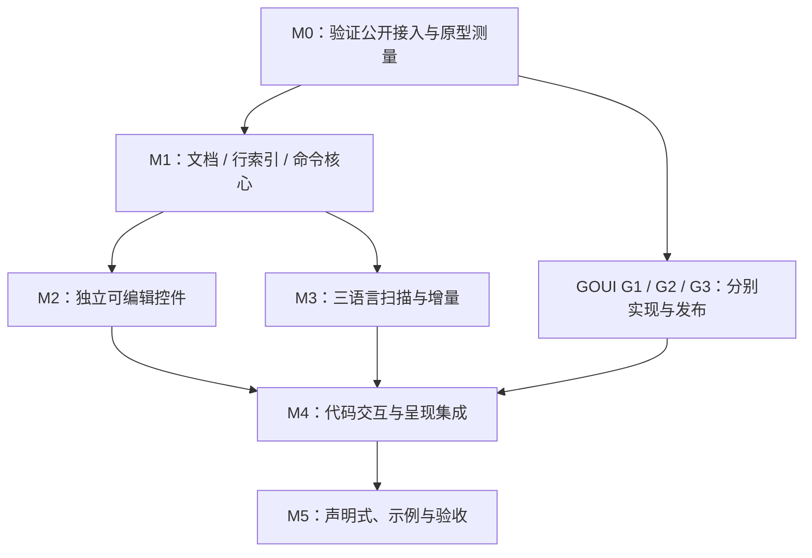

# SourceView 开发与验收计划

> v0.1.0 已发布；实际验收范围及仍未覆盖的平台组合见下方发布记录。
> 实际代码、命令、结果与限制见本文件及对应专题的 Plan 文档。
> 首版范围见 [总设计](DesignSourceView.md)，场景与目标见 [Testing](Testing.md)。
> 下列待办是开发切片，不构成未经用户授权就修改代码或其他仓库的许可。

当前依赖为 GOUI v0.3.0，已发布 v0.1.0。早期各切片中的未发布
依赖及失败描述保留为当时记录，当前验证结果以发布记录为准。

## 侧栏与折叠指针（2026-10-23）

- [x] 正文保留配置的文本指针；行号及侧栏空白使用箭头，可点击的折叠按钮与
  已绘制占位标记使用手形。拖选期间保持起始区域的指针；内部查找／定位输入
  的指针隔离不变。命中读取已有段落几何，不因鼠标移动创建原生布局。
- [x] 现有 input 测试增加命中区域、拖选起点、自定义正文指针和缺少缓存时
  不测量的断言；folding 窗口程序通过正常 PointerEvent 验证实际分发与拖选。
- [x] Linux amd64 / Go 1.25.8 / Pango：`go test ./...`、
  `GOWORK=off go test -json ./... -count=1` 通过，419 PASS、0 FAIL、0 SKIP。
  独立 X11 / Xvnc / Xfwm4 合成桌面、Software、150% 应用缩放，folding
  亮暗两组通过。同一新窗口用例在 `1b6ed8c` 冻结检出上于
  `fold toggle retained text cursor` 失败，确认能够复现修正前行为。
- 本轮没有修改 GOUI，依赖仍为 v0.3.0；Windows/macOS 原生指针外观尚未验证。
  日志与程序保存在仓库外，不写剪贴板或修改用户文件及系统设置。

## 内置查找、替换与定位（2026-10-23）

- [x] SourceView 默认处理查找、替换和定位命令，内部栏首次打开时创建，
  查询和替换文字在隐藏后保留。查找／替换与定位互斥，卸载关闭并释放订阅，
  重新挂载后可再次打开。各视图的输入、焦点和生命周期相互独立。
- [x] 公开操作收敛到 `ShowFind() error`、`ShowReplace() error`、
  `ShowGoTo() error` 与 `HidePanel()`；默认快捷键及 `KeyBindings` 配置方式不变。
  解除绑定后应用可收到原按键，直接操作仍可使用。不增加面板枚举或声明式可见状态。
- [x] 删除根包公开 FindBar／GoToBar 类型和 ui 对应绑定；调用方不再声明 Overlay、
  Target 或互斥回调。示例、窗口验证、设计与应用技能参考同步迁移。
  此变更尚未发布；已发布 v0.1.0 的旧组合接口与当前 main 不同，详见
  [内置界面设计](DesignFindBar.md)。
- [x] 内部子树通过 GOUI 公开 Widget 契约参与布局、命中、焦点、输入和语义。
  浮层固定在视口右上角、保留 8 DIP 边距，不参与正文大小或滚动范围。
  正文拖选和右键菜单限于 Target 阶段，栏内输入不改变正文选区或重复打开菜单；
  正文 I-beam 不向内部工具栏继承，输入字段仍使用自己的文本指针。
- [x] Linux amd64、Go 1.25.8、Pango：`go test ./...` 和
  `GOWORK=off go test -json ./... -count=1` 通过，后者 418 PASS、0 FAIL、0 SKIP。
  以改动前 `7197dd8` 的冻结检出为基线，原有 416 项全部保留，并新增未挂载操作
  不创建子树、隐藏保留查询与选区的两个包内回归用例。
  `GOWORK=off go test -race ./... -count=1`、`GOWORK=off go vet ./...` 通过。
- [x] 独立 X11 / Xvnc / Xfwm4 合成桌面，Software / Pango、150% 应用缩放：
  keybindings、search 的亮暗组合，find_appearance 的字号 14 / 18 及亮暗作用域，
  find、localization、shortcuts、assistance 亮暗和 markup 全部通过。
  keybindings 额外断言打开浮层不改变正文滚动范围、滚轮使正文滚动而浮层边界不变，
  亮暗两组均通过。find 保留计数、替换、撤销、只读及重入断言，增加延迟创建、
  重建、多视图隔离、解除绑定、移除／重挂载、栏内拖选、右键菜单和指针回归。
- [x] 同一独立桌面运行声明式示例，以 XTest 鼠标与按键打开查找、输入 `editor`、
  切换到定位并 Escape 关闭；截图观察确认结果高亮、浮层互斥和正文焦点恢复。
  应用技能文档中的完整最小示例在关闭工作区后构建通过，变更 Markdown 的
  本地链接路径和代码围栏检查通过。
- [x] Windows amd64 与 macOS arm64：`GOWORK=off CGO_ENABLED=0` 下根包
  `go test -c` 及全仓 `go build ./...` 通过。本轮未做两端原生窗口验收，
  未验证真实 IME、系统保留键或混合 DPI；交叉编译不计作这些场景通过。
  本轮未修改 GOUI，模块依赖仍为 v0.3.0；本地工作区 GOUI 为
  `d7280cb08ff08e0ac31ef5e8c87a194f5d440a63`。
  程序、日志及截图均放仓库外临时目录，测试未写剪贴板或修改用户文件、系统设置。
  示例正常关闭，专用 X11 与窗口管理器进程已退出，用户桌面会话未动。

## 进一步合并源码与测试文件（2026-10-23）

- [x] 按用户要求继续合并同类小文件：根包源码从 38 个减少到 22 个，
  主题注册及控件样式集中到 `styles.go`，分析和排版工作集中到 `scheduler.go`；
  补全队列和面板、查找范围切换、折叠绘制和工作队列、编辑辅助绘制、剪贴板和
  注释命令、可见行映射及生命周期分别合入所属功能文件。
- [x] `ui/bars.go` 合并查找与定位绑定；语言的上下文查询合入内置定义，
  高亮引擎的上下文和 token 辅助集中维护，字面量与正则搜索放在同一实现文件。
  不新增包、接口或依赖，源码合并提交为 `e922bb3`。
- [x] 根包测试从 45 个减少到 21 个，全仓测试文件从 67 个减少到 32 个。
  共享辅助设施集中到 `test_helpers_test.go`，编辑、输入、辅助、补全、折叠、
  配套控件、布局、原生验证及实验分别按领域合并。内部 editor 和 highlight
  各保留两个测试文件；语言内部用例集中到 `language_test.go`。
- [x] 保留三个通过文件名选择平台的 Context 工厂，以及 `package language_test`
  的外部公开契约测试；不为合并文件改成运行时平台选择或绕过包边界。
  窗口程序与示例的入口路径不变，用户 `example/temp/` 未修改。
- [x] 仓库外脚本逐项核对：254 个测试／基准等入口全部保留，
  各包的 1046 个非 init 源码声明和 383 个测试声明的语法树保持一致。
  Basic、Modern 的两个 init 合为一个，原有注册调用及先后顺序不变。
  未删除断言、修改期望或扩大跳过条件。最新落位见 [测试约定](Testing.md)。
- [x] Linux amd64、Go 1.25.8、Pango：整理前后 `go test -json ./... -count=1`
  均为 416 PASS、0 FAIL、0 SKIP，逐项结果相同；
  `GOWORK=off go test -json ./... -count=1` 同样通过。
  工作区 GOUI 为 `d7280cb08ff08e0ac31ef5e8c87a194f5d440a63`，关闭工作区使用
  GOUI v0.3.0，未修改 GOUI、模块依赖或本地工作区配置。
- [x] `GOWORK=off go test -race ./... -count=1`、`GOWORK=off go vet ./...` 通过。
  `GOWORK=off CGO_ENABLED=0` 下，Windows amd64 与 macOS arm64 的根包测试程序
  `go test -c` 及全仓 `go build ./...` 通过；本轮仅交叉编译，未做远端原生运行或窗口验收。
  无桌面、剪贴板及系统设置副作用，验证脚本、日志和二进制均放仓库外临时目录。

## 第一轮代码与测试组织整理（2026-10-23）

- [x] 按职责拆分原 `layout.go`：视口布局、段落缓存、命中与滚动定位、绘制分别维护。
  合并同类编辑命令，剪贴板与搜索独立成文件；生命周期及样式变化处理回到对应职责。
  SourceView 字段按用途分组，不新增状态对象、公共 API 或 GOUI 改动。
  源码整理提交为 `805096e`；职责入口见 [总设计](DesignSourceView.md#3-包与依赖)。
- [x] 根包测试文件从 55 个归并为 45 个。共享文档观察器、输入法复位替身、模拟排版、
  绘制记录器及原生调用计数与度量辅助设施集中维护；搜索、着色、缓存、编辑命令、
  快捷键和定位用例按领域归位。窗口程序、示例与其他包的路径保持不变。
- [x] 有界分段排版原型改名为 `layout_experiment*_test.go`，仍参与默认测试，保留反例
  和基准，未接入生产控件。使用仓库外临时脚本核对 254 个测试／基准等入口全部保留；
  逐声明比对 Go 语法树，除 SourceView 字段重新分组及三个测试辅助类型重命名外，
  声明与函数体一致，字段名称和类型也保持一致。未删除断言或扩大跳过条件。
- [x] Linux amd64、Go 1.25.8、Pango：整理前后的 `go test -json ./... -count=1`
  均为 416 PASS、0 FAIL、0 SKIP，逐项用例与结果相同；
  `GOWORK=off go test -json ./... -count=1` 同样通过。
  工作区 GOUI 为 `d7280cb08ff08e0ac31ef5e8c87a194f5d440a63`，关闭工作区时使用已发布的
  GOUI v0.3.0。未修改 GOUI 或用户的 `example/temp/`。
- [x] `GOWORK=off go test -race ./... -count=1`、`GOWORK=off go vet ./...` 通过。
  `GOWORK=off CGO_ENABLED=0` 下，Windows amd64 与 macOS arm64 的根包 `go test -c`
  及全仓 `go build ./...` 通过；仅为交叉编译，本轮未执行远端原生运行或窗口验收。
  不以无测试的窗口程序包编译成功代替其场景通过。验证产物保存在仓库外临时目录，
  无新增窗口、剪贴板或系统设置副作用。

## v0.1.0 正式发布（2026-10-23）

- [x] 候选 `fcacbe5e27030494aed0b33d06e9e460c665d36e` 已在 origin/main，
  annotated tag 的远端 peeled SHA 与其一致；未移动既有标签。LICENSE 与 GOUI
  的 MIT 及版权署名逐字节一致。依赖与发布说明已提交，未纳入用户 example/temp。
- [x] 从候选 git archive 再次关闭 workspace 验证，Go 1.25.8 / GOUI v0.3.0：
  Linux 全仓非缓存测试 416 项通过、零失败/跳过，vet 零诊断，模块 verify、
  tidy -diff 及 Linux amd64 / Windows amd64 / macOS arm64 无 cgo 全仓构建通过。
  全部 Go / module 文件与完成 race、两端原生测试的源码快照逐字节一致。
- [x] Mac / CoreText、Windows / DirectWrite 原生根包各 268 项通过、零失败/跳过。
  Mac 原有八项、Windows 原有两项（均含父测试）已修复，未以豁免或修改容差发布。
  片段只保留普通测量值和放置坐标，严格原生比较、源范围、输入预算及原有的
  隐式上下文反例均保留。实际控件没有启用这些有界输入实验。
- [x] 桌面输入、窗口专项及副作用见准备记录。Windows 所需 ASR 规则在授权后
  临时停用，finally 恢复且最终再次核对全部 16 条规则一致；实时防护始终开启。
  本轮独立 X11 / Xfwm4、窗口、专用 Terminal 和传输 HTTP 均已关闭，保留用户会话。
- [x] Draft 的标签、标题、中英文说明和无手工附件范围核对通过；
  [v0.1.0 Release](https://github.com/golang-gui/goui-sourceview/releases/tag/v0.1.0)
  已正式公开、非预发布、Latest。只发布 Go 库与源码示例，不提供二进制 Demo，
  公证及手工附件校验不适用，不创建空 SHA256SUMS。
- [x] 仓库外 GOWORK=off / proxy.golang.org 解析到 v0.1.0 及正确候选 SHA；
  无 replace 的消费模块实际下载、tidy、verify、构造 Document / SourceView、
  配置 JSON 语言并运行通过，根包、language、scheme、ui 与 Modern 集成的三目标
  编译通过。消费方解析的 GOUI 为 v0.3.0，下载的 LICENSE 与原件一致。
- [x] 中英文 README 在公开验证后加入 v0.1.0 安装命令；随文档收尾提交，
  标签继续固定在冻结候选。完整日志与双语发布说明归档位置见下节。
- 仍未完整验证真实 IME、混合 DPI 和全部绘制后端/缩放组合；复杂超长段落首次
  原生排版仍可能阻塞。不将测试内原型通过或三目标构建当作这些能力已全面验收。

## v0.1.0 发布准备（2026-10-23）

- [x] go.mod 更新到已发布的 GOUI v0.3.0，移除本机 replace；保留忽略的 go.work
  供双仓开发。干净源码 tidy 同步 cgo v0.1.1、nanovgo v0.0.9，并正确分类
  直接使用的 x/text；同步 go.sum 及示例指南，不修改相邻 GOUI 仓库。
- [x] 增加 [发布流程](Release.md)，按 Go 库及源码示例交付；本次不分发示例二进制，
  签名、公证、手工附件与附件校验文件不适用。
- [x] 初步干净源码验证：Go 1.25.8 / Linux amd64 / Pango，GOWORK=off，
  全包非缓存测试 415 项通过、零失败/跳过；vet 零诊断，三目标全仓构建通过。
- [x] 同源快照 `GOWORK=off CGO_ENABLED=1 go test -race ./... -count=1`
  通过；模块 verify / tidy -diff 通过。没有把未跟踪 example/temp 纳入验证或提交。
- [x] Linux Ubuntu 22.04.5 / Xvnc :85 / Xfwm4 合成开启 / Pango / Software：
  150% 的 frame、experience、extensions、find_appearance、keybindings、folding、
  languages、markup 窗口自动断言通过。completion scroll 在
  1/1.25/1.5/1.75/2 倍的 Modern 亮暗十组通过；1.5 倍另重复六次通过。
  修正了首帧前取样的测试时序，旧入口三次均明确失败，未修改生产弹窗或扩大容差，
  详见 [补全记录](PlanCompletionScrolling.md)。
- [x] 正式 editor 示例由正常桌面输入检查 Linux 软件绘制 1.5 倍及 macOS 默认
  缩放：编辑、补全、查找、右键菜单及窗口调宽高。Mac 另验证真实复制/删除/粘贴、
  撤销/重做、亮暗切换；查找 editor 均显示两个匹配。Mac Integrated 日志确认为
  mode=1、enabled=true、controls=2，示例退出码 0；不分发此验证用二进制。
- [x] Mac completion scroll 和 experience 在桌面 Terminal 启动，均返回 0；
  日志确认 CoreText / OpenGL、scale=1。前者覆盖补全宽度、滚轮、拖动、Reveal、
  留白、焦点与撤销；后者覆盖双/三击、局部选区颜色、菜单、JSON/HTML 补全、
  过期异步结果、配对及原子历史。上述生产路径通过不抵消下面的实验测试失败。
- macOS 15.7.7 / arm64 / CoreText 首次原生根包测试退出 1：259 项通过、
  8 个测试及子项失败，集中在 `TestExplicitContextFragmentProbe` 的四个子项和
  `TestBoundedFragmentProbeMatchesSimpleParagraphs` 的两个子项及各自父测试。
  失败与 [原有记录](PlanRemoteEditingLatency.md#验证命令与未通过项) 一致：
  独立输入片段的纵向坐标/基线或双向几何不等于完整段落。两种实验仅存在于
  `*_test.go`，正式控件未启用，未移除断言、扩大 skip 或改变预期来制造通过。
- Windows 10 19045 / amd64 首次原生测试被阻止：下载尺寸和 SHA256 一致，
  权限含 ReadAndExecute，但两种正常启动方式均被 Defender Exploit Guard
  事件 1121 拦截，规则 ID 为 C1DB55AB-C21A-4637-BB3F-A12568109D35。
  当时保留系统安全策略并停止重复启动；三目标交叉构建不算原生运行通过。
- [x] 维护者确认许可证与 GOUI 一致：LICENSE 逐字节复制 MIT 及同一版权署名，
  中英文 README 补充许可证入口。维护者要求修复 Mac 失败，并明确授权临时关闭
  Defender 完成 Windows 验证；没有把实验失败作为已知限制直接发布。
- [x] 两个实验修正片段放置和近处上下文：占用高度不等于下一行推进，以完整重叠
  行实测基线定位；每步附带上一条已完成的真实源文本行，恢复数字解析上下文。
  输入预算、范围/行/簇/坐标/基线严格断言及隐式上下文反例均保留，未改正式控件
  或 Typography。详见 [修正记录](PlanIncrementalTextLayout.md#分段实验的原生坐标修正2026-10-23)。
- [x] Mac / CoreText 与 Windows / DirectWrite 的最终根包测试各 268 项通过，
  零失败/跳过，原生程序实际退出 0。Linux 全包 race 通过；新增固定行距回归
  不依赖宿主字体，原包测试数为 415，加入后为 416。
- [x] Windows 只临时停用命中的 ASR 规则 C1DB55AB-C21A-4637-BB3F-A12568109D35，
  通过 finally 恢复原值，并核对全部 16 条规则逐项一致；实时防护一直开启。
  真实桌面使用 RDP 1600×900、系统 DPI 96、应用 1.5，验证正常窗口到最大化、
  编辑、Tab 确认补全、真实复制/删除/粘贴、撤销/重做、查找、右键菜单及主题。
  补全 scroll 和 experience 自动断言均返回 0，日志确认 DirectWrite / Direct2D。
  桌面验证及后续原生复测后均恢复防护，无永久排除项。
- [x] annotated tag、Draft、公开 Release、Go proxy 和消费方验证，以及中英文
  README 安装指引均已完成，结果见上方正式发布记录。
- 日志、干净源码、截图、验证程序与双语发布说明草稿保存在
  `/tmp/goui-sourceview-release-v0.1.0-punsevvv`；Mac 专用目录为
  `/private/tmp/sourceview-v010.VebMVy`。Mac、Windows 真实复制验证将剪贴板文本改为
  true，未保留原内容；其余窗口自动测试不访问真实剪贴板。编辑只改内存，未写用户
  文件、修改系统缩放或修改相邻 GOUI。临时安全配置变化已恢复，真实 IME、混合 DPI
  和全部后端组合未验收。
  本轮示例、窗口专项、Mac 专用 Terminal、独立 X11 / Xfwm4 和传输 HTTP 均已关闭，
  保留原有远端连接。此前依赖及窗口验证程序提交后，干净 git archive 再次执行 415 项测试、
  vet、模块校验、tidy -diff 与三目标构建均通过，窗口修正未带来新增包测试失败。

## 编辑器统一外框（2026-10-22）

- [x] SourceView 注册 frame 与滚动条样式，示例和窗口用例显式设置宿主样式。
- [x] 独立 X11 的 TextView / SourceView 双编辑器验证，Basic / Modern 亮暗
  与 1/1.5/2 倍通过；本机包测试、定向 race 与目标交叉构建通过。
- GOUI 需要尚未发布的 `2a0dfef`、`1d3aebd`；发布依赖、既有 150% 补全
  宽度失败及桌面副作用见 [本轮记录](PlanEditorFrame.md)。

## 长段落排版优化（2026-10-20）

已优化共享几何查询与可视行装饰范围。保持完整上下文的分步原生分析、
测量复用和事件循环集成仍待完成，首次长段落自动换行仍可能阻塞窗口。
本轮需要尚未发布的 GOUI 工作区改动，依赖及验证见
[实施记录](PlanIncrementalTextLayout.md)，不以早前 v0.2.0 验证覆盖当前状态。

## 结构化文档编辑体验（2026-10-19）

折叠优先，其次编辑辅助、标记语言和查找增强；编程语言、多光标、通用装饰与语言服务后置。
具体设计见 [折叠](DesignFolding.md)、[编辑辅助](DesignEditorAssistance.md)、[标记语言](DesignMarkup.md)，
实际切片和验证统一见 [本轮实施记录](PlanEditorFeatures.md)。需要 GOUI 新契约时在该记录列出要求并跳过，不阻塞其余实现。

## 自定义语言与 Markdown（2026-10-19）

- [x] 公开不可变语言/扫描契约、自定义样式键与独立词法角色，迁移六种内置语言。
- [x] 统一词边界、多字符配对、换行/注释及有文档身份/修订防护的编辑事务。
- [x] 可取消后台补全、空前缀触发、提供者候选控制、每项范围/光标与附加编辑，薄声明式绑定。
- [x] 完全使用公开 API 的 Integrated / Modern Markdown 编辑器，纯逻辑及窗口验证。
- [x] 本机 test/race/vet、Software 1×/2×、OpenGL 1×，Windows/macOS 示例交叉构建。
- [ ] Windows/macOS 原生窗口、真实 IME/物理快捷键、混合 DPI。
- [x] 可获取 GOUI 依赖的独立构建：已接入 v0.2.0，结果见第 14 节。

具体改动、过程中发现的缺陷、命令及适用条件见 [扩展验证](PlanLanguageExtensions.md)。

## 中英文 README 与示例（2026-10-18）

- [x] 根目录英文 README、`doc/README_CN.md` 聚焦项目展示；运行前置与操作说明集中到示例指南，完整接入代码保留在示例中。
- [x] 示例目录统一为 `example/`，命令式三语言样本各自保留文档历史，两个入口均使用 HeaderBar / Integrated / Modern。
- [x] 本机 Linux / X11 / Xfwm4（合成开启）/ Software 1x 运行；命令式 ChromeInfo 确认 mode=1、enabled=true、controls=1。
- [x] 浅色 JSON、深色 HTML 与浮动替换栏的真实窗口截图位于 `doc/images/`，两份 README 复用；只截取窗口边界。
- [x] 系统输入路径检查三语言切换、主题切换、HTML 搜索 `feature` 两处匹配、编辑后切换保留、撤销及只读；声明式窗口检查 Ctrl+F 搜索 `editor` 一处匹配。
- [x] `go test ./...`、`go vet ./...`；初版 README 的 Go 程序构建和本地链接/图片检查通过；两个示例均以 CGO_ENABLED=0 构建 Linux amd64、Windows amd64、macOS arm64 通过。

GOUI 使用 `903daf8`，未修改其工作副本。截图环境为本机 Ubuntu 22.04.5 / Go 1.25.8 / Pango；
Windows/macOS 本轮仅交叉构建，未进行原生运行。真实 IME、系统保留快捷键和混合 DPI 未验收。
`GOWORK=off go test ./...` 仍在既有 ApplyBatch / BatchOptions 依赖处失败。
示例只修改内存，未改写剪贴板或系统设置；完成后关闭了本次启动的窗口。

## 中大文件功能验证（2026-10-18）

- [x] 独立常规 JSON/XML/HTML 样本及完整内容、导航、编辑、搜索替换和历史验证程序。
- [x] 首/中/尾原生语法色、共享视图、只读、重新挂载及顶部锚点断言。
- [x] Linux 十组规模/后端/缩放配置执行完成并记录失败；本机 test/race/vet、Windows/macOS 包测试及构建通过。
- [x] 冷定位保留逻辑请求、测量目标附近行、按宿主偏移确认完成；原十组窗口配置各 53 步零失败。
- [ ] Windows/macOS 中大文件真实窗口、真实 IME、分数/混合 DPI。

本阶段资源占用和性能优化后置；通过、失败及验证范围见 [中大文件验证](PlanLargeFiles.md)。

## 菜单与查找栏多语言（2026-10-18）

- [x] 本模块界面资源集中维护，编辑菜单及查找栏提示、名称和计数补齐八语言。
- [x] 旧版复现、地区匹配/英语回退、计数格式和诊断保留的包测试。
- [x] 展开菜单实时翻译、状态与焦点保留、长文本、窄宽度、卸载重挂窗口断言。
- [x] 本机 test/race/vet；Linux Software 1x/2x、OpenGL 1x；Windows/macOS 原生包测试与窗口构建。
- [ ] 母语校对、Windows/macOS 桌面、真实输入/IME、分数与混合 DPI。

范围、提交、命令及发布限制见 [多语言验收](PlanLocalization.md)。

## 代码选区与语法色（2026-10-17）

- [x] 默认保留语法前景，活动/非活动选区使用真实透明背景；保留显式统一前景选项。
- [x] 隔离根样式前景继承，规范化空选区和透明前景，保留原生回调重入保护。
- [x] 旧版复现、样式/缓存回归、三语言 × 三主题窗口像素与资源释放断言。
- [x] 本机 test/race/vet；Linux Software 1x/2x、OpenGL 1x；Windows/macOS 原生包测试与窗口构建。
- [ ] Windows/macOS 实际桌面、物理输入/IME、分数与混合 DPI。
- [x] 包含所需 GOUI API 的可获取版本及关闭工作区的独立构建：GOUI v0.2.0，见第 14 节。

范围、提交、命令与验证边界见 [代码选区验收](PlanSelection.md)。

## Basic / Modern 样式接入（2026-10-17）

- [x] GOUI 两个主题各自 Register、确定规则组合与 GUI 默认缓存延迟构造。
- [x] 根包自动登记 Basic / Modern；代码、FindBar 和补全遵循当前样式。
- [x] Scheme 限于代码色；移除控件内部固定样式表与自动配色设置订阅。
- [x] 样式覆盖、并发构造、原生资源与回调重入回归；示例统一使用 Modern。
- [x] 两仓本机测试、相关 race；Linux Software 1x/2x、OpenGL 1x 与 18 pt 字体窗口验收。
- [x] Windows/macOS 原生包测试、GOUI 受影响包测试与窗口程序构建。
- [ ] Windows/macOS 桌面外观、真实 IME、分数/混合 DPI。
- [x] 依赖包含所需 GOUI API 的可获取发行版后通过关闭工作区的独立构建：GOUI v0.2.0，见第 14 节。

范围、提交、命令及结果见 [样式接入验收](PlanStyles.md)。

## 查找替换浮层外观（2026-10-17）

- [x] 右上角 Overlay、单行查找/二行替换、矢量图标、输入内开关与窄宽度布局。
- [x] 独立配色、显式子树样式与局部阴影，更新两个示例及原有生命周期窗口验证。
- [x] 新增外观断言、旧版复现、亮暗并列截图和实际 WM 缩窄检查。
- [x] 本机包/race/vet、Software 1x/2x、OpenGL 1x；Windows/macOS 原生包测试及窗口程序构建。
- [ ] Windows/macOS 实际桌面外观、真实 IME、分数/混合 DPI。

改动、依赖提交、通过/失败命令与验证边界见 [浮层验收](PlanFindBarAppearance.md)。

## 编辑快捷键与可选查找栏（2026-10-17）

- [x] 常用编辑/导航组合键、平台修饰键、词边界、撤销和共享文档回归。
- [x] 独立命令式 FindBar、按需打开、输入/选项/计数/替换、挂载和失效处理。
- [x] 薄声明式目标接入、重建查询保留、两个示例更新。
- [x] 本机全包、race、vet，Software 1x/2x、OpenGL 1x 窗口；Windows/macOS 原生包测试与构建。
- [ ] 远端真实桌面、物理按键/IME、分数及混合 DPI。
- [ ] 程序化跨行查询的弱装饰与核心序列进一步统一，多行查询输入等按专题推进。

实现、回归证据与平台边界见 [查找栏和快捷键验收](PlanFindBar.md)。

## 逻辑行编辑（2026-10-16）

- [x] 移动、复制、删除逻辑行，部分/反向选区、下一行首排除、空行及 EOF 处理。
- [x] 原子历史、共享视图映射、32 MiB 插入预算、模式与回调重入检查。
- [x] 平台快捷键、菜单及可用状态，同步更新 API、设计和说明。
- [x] 本机全包、race、vet，Software 1x/2x、OpenGL 1x 窗口和 Windows/macOS 包验证。
- [x] 复现并修正销毁后公共编辑入口仍可修改共享文档的问题。
- [ ] Windows/macOS 实际桌面快捷键/菜单、真实 IME 及混合 DPI。

实现、分步提交与验证边界见 [行编辑验收](PlanLineEditing.md)。

## 补全列表视觉调整（2026-10-16）

- [x] 独立亮暗面板配色、名称/说明分列、前缀强调、Cluster 边界省略和词首定位。
- [x] 稳定尺寸、完整可见行、滚动位置提示，修正留白区域误接受候选。
- [x] 几何/文字颜色/Unicode/资源/取消回归，本机全包、race、vet 与 Windows/macOS 原生包测试。
- [x] 独立 X11 的 Software 1x/2x、OpenGL 1x 窗口输入及真实截图、颜色断言。
- [ ] Windows/macOS 补全面板实际桌面、分数缩放与更多字体矩阵。

实现、命令、证据及发布限制见 [补全视觉验收](PlanCompletionAppearance.md)。

## 括号提示视觉调整（2026-10-16）

- [x] 独立亮暗配色、淡底与 1 DIP 内缩边框，仅显示已确认配对。
- [x] 几何/层次/透明/共享 Cluster 回归，本机全包、race、vet 与 Windows/macOS 包测试。
- [x] 独立 X11 的 Software 1x/2x、OpenGL 1x 真实截图与颜色断言。
- [ ] Windows/macOS 新边框窗口、分数缩放与字体矩阵。

改动、命令、证据及发布限制见 [括号视觉验收](PlanBracketAppearance.md)。

## 编辑体验后续切片（2026-10-16）

- [x] 修复双击松开缩回 caret、词尾后半部误命中；加入三击和按词正反拖选。
- [x] 通过原生局部选区前景回归，补充窗口焦点/菜单活动配色失效处理。
- [x] 编辑菜单、权限与历史、通用菜单键盘导航。
- [x] JSON/XML/HTML 语言名称与附近文档词补全、提供者、弹窗、取消及重入隔离。
- [x] 括号闭合/跳过/包裹/成对删除、空括号缩进和词法匹配装饰。
- [x] ui 薄选项、本机三种 painter/scale 窗口组合、Windows/macOS 原生逻辑/排版验证。
- [x] 两仓按职责与功能分别提交，保留无关工作副本改动；未推送。
- [ ] Windows/macOS 新弹窗桌面、真实 IME、规模及独立发布验收。

具体版本、命令、通过/失败/未执行与边界见 [编辑体验验收](PlanEditorExperience.md)。

## 1. 依赖与切片顺序

这是工作依赖图，不要求使用并行代理。GOUI 的每项扩展分别验证；
不把给 TextView 加装饰入口放在任何阶段。

## 2. M0：能力核验与风险原型

- [x] 以实际依赖版本核对 Widget、IME、Scrollable、typography 与 frame 的公开契约。
- [x] 用外部类型嵌入 WidgetBase 的最小原型验证焦点、输入、排版、滚动、快照及 mount/unmount。
- [x] 验证固定行号侧栏的坐标和 reveal 公式，不先引入自有滚动宿主。
- [ ] 验证顶部锚点恢复与宿主 ScrollIntoView/范围钳制的相容性。
- [x] 验证 AcceptsTab、只读及 Escape 后一次 Tab 放行确实进入 GOUI 默认焦点遍历。
- [ ] 测量常规与超长行 native shaping/命中开销，确认首版 profile 的风险边界。
- [x] 验证 token/选择前景变化的三端原生度量及 Geometry 复用条件；已测样本与边界见 [着色缓存验收](PlanColorCaching.md)。
- [ ] 为 G1/G2/G3 各自保留最小复现和接口评审说明，确认依赖版本策略。

产物：真实 API 使用证据、基线测量与具体扩展切片；原型资源放临时或专门验证位置，
不把私有 TextView 实现复制成正式起点。
退出：明确能直接使用的能力、阻塞验收的通用缺口和不可承诺的规模，不留下伪造 API。

## 3. GOUI 通用扩展

详细契约见 [DesignGOUIIntegration](DesignGOUIIntegration.md)。

| 项 | 阻塞的交付 | 独立验收 |
| --- | --- | --- |
| G1 ApplyBatch / 历史前后选区 | 多行缩进、反缩进、ReplaceAll 的一次撤销 | 原子性、UTF-8、通知/修订、历史与重入 |
| G2 typography TabWidth | 用户可配置 Tab 宽度 | 三后端度量、范围、命中、RTL/折行与默认兼容 |
| G3 Clipboard 结果 | 失败安全的 Cut 和可解释的读写错误 | 原生失败、空/无文本、同步回调、旧调用点迁移 |

- [x] 按 GOUI 的 AGENTS 分别实现并验证 G1/G2/G3，记录实际接口及拆分提交，不混入源码领域依赖。
- [x] 两仓本地 workspace 联调与 Windows/macOS 原生专项结果分别记录。
- [x] 发布包含通用扩展和当前修正的可获取版本，更新依赖并通过 GOWORK=off 独立验证：GOUI v0.2.0，见第 14 节。

G 项没有完成前，相关 SourceView 功能可以开发或局部测试，但不能标记对应验收已通过。

## 4. M1：文档和编辑算法

- [x] 建模块、首批纯逻辑包和 testdata，保持实际可获取的 GOUI 依赖。
- [x] Document 对 Model 的组合、语言 epoch、挂载期订阅与复用策略。
- [x] lineStore 稳定身份、旧 byte 索引、按序 Change 映射和 Reset。
- [x] EditPlan、简单输入/删除、选区映射、历史分组与重入校验。
- [x] 基础缩进和线性字面量搜索计划；G1 未到位时先断言计划，不假装已原子提交。
- [x] 朴素参考与确定性随机编辑断言。

退出：纯逻辑测试不需要桌面；byte/line/选区/修订与独立预期一致，
跨行编辑不会让行索引和模型脱节。

## 5. M2：独立编辑 Widget

- [x] 叶子 SourceView、IMClient、Scrollable 与可见布局。
- [x] 普通文本排版、Geometry、HeightIndex、视口与 native cache。
- [x] 光标导航、鼠标选择、手势取消、焦点与挂载期资源。
- [ ] IME 投影、候选框、提交与取消；不依赖 TextView 输入控制器。
- [x] 剪贴板 pending 身份、基本 Undo/Redo、只读。
- [x] 语义快照包含有界可见原文和独立 preedit。

退出：无高亮的独立编辑器已可在真实窗口完成输入、选择、滚动和 IME；
逻辑回归、native 资源释放及首个桌面场景有记录。

## 6. M3：JSON / XML / HTML 与增量

- [x] 内置 language 元数据、Kind、三种独立扫描状态和 Scheme 映射。
- [x] 手写 token/状态样本、非法与不完整输入、分片边界。
- [x] 工作片段、预算、行末状态、dirty 区间与收敛。
- [x] 插删行对齐、语言切换、同文档多视图和 token LRU。
- [x] 冷定位 Plain 降级、任务代次、最后视图卸载停止驱动。
- [x] 三语言全部进入演示与编辑回归，HTML 不作为 XML 的别名交付。

退出：手写独立语义预期及增量对照通过；普通局部编辑不扫无关全文，
错误/未知区域不会破坏输入。

## 7. M4：完整首版集成

- [x] G1/G2/G3 实际版本接入并运行本机回归：GOUI v0.2.0；未完成的原生矩阵按专题保留。
- [ ] 行号、横向固定侧栏、折行、Tab、锚定与 reveal。
- [x] 多行缩进/反缩进、换行缩进、查找替换及一次撤销。
- [x] 亮暗、选区/搜索/当前行叠加、caret 与投影样式。
- [ ] 常规规模和极端样本，记录性能目标、资源峰值与残余限制。

退出：所有首版功能有对应测试与可观察结果；“暂缺通用扩展”的项目不能留作隐含已完成。

## 8. M5：声明式、示例与发布验证

- [x] 薄 WidgetView、稳定 Document、可选配置恢复与单份信号连接。
- [x] 挂载/卸载/文档替换时的 OnChange/OnSelection/OnError 正确管理。
- [x] 示例包含三种必需语言、可编辑与只读、行号、主题及查询。
- [x] tests/window 各主题入口注释与逐项预期。
- [ ] go test、相关 race、独立依赖与目标编译。
- [ ] Linux/Windows/macOS 关键输入、IME、Tab、剪贴板与缩放验收。
- [ ] 同步使用文档、已知限制及版本兼容；不把编译写成原生验收。

退出：能从设计链接找到 API、示例、测试与真实结果；发布所用依赖可获取。
某平台未验收时如实标注，不擅自改变三语言与可编辑的首版定位。

## 9. 实施状态说明

上面的勾选表示相关代码及已记录的验证已落地，不代表专题中的全部平台矩阵通过。
IME 投影、G1/G2/G3 三后端实现及顶部锚点已有代码；它们各自尚未完成的原生矩阵保持未勾选。
G1/G2/G3 已随 GOUI v0.2.0 发布并通过本机独立依赖验证；历史失败仍保留在 Implementation，各平台尚未完成的原生验收不受此项影响。

## 10. 设计交付

- [x] 明确独立控件、Document/视图所有权及公共 API 草案。
- [x] 细化命令、历史、IME、剪贴板、搜索及声明式绑定。
- [x] 细化三语言扫描、行身份、增量传播与预算。
- [x] 细化排版、Tab、滚动、固定侧栏、装饰与资源。
- [x] 记录已核对的 GOUI 源码及 G1/G2/G3 通用扩展提案。
- [x] 建立测试矩阵、初始性能目标及后续切片门槛。
- 文档检查结果在本轮交付说明中报告；以上勾选不表示任何实现或运行验收完成。

## 11. 着色缓存与度量稳定性（2026-10-16）

- [x] 先用回归复现配色/选区重建 native layout 和语言切换改写 LineID。
- [x] 分离着色状态与排版身份，完整覆盖旧前景；缓存初始索引转接、语言切换及重入资源释放。
- [x] 三端实际验证度量稳定、独立颜色预期位图、资源隔离与释放；DirectWrite 旧范围回收另在 GOUI 修正并复现前后差异。
- [x] Linux Software 1x/2x、OpenGL 1x 的正常焦点/选区重着色断言及原有编辑窗口断言通过。
- [x] 本机全仓/race/vet、远端全仓、目标编译及同环境前后计数/基准，见 [验收记录](PlanColorCaching.md)。
- [ ] 常规大文件、超长行 shaping、真实 IME 与跨屏矩阵仍按原计划推进；本切片不将这些目标标为通过。

## 12. TOML、YAML、Shell（2026-10-19）

- [x] 三种语言的有状态高亮、识别、基础补全与引用配对。
- [x] 分片、超长键/数字/delimiter、增量恢复、畸形语法及 Unicode 字符范围边界回归。
- [x] 原创示例、双语 README 语言列表及具体设计同步。
- 原生排版、窗口矩阵、独立依赖结果与未验证项见 [验收记录](PlanLanguages.md)。

## 13. 应用开发 Skill（2026-10-19）

- [x] 在本仓库维护 `skills/goui-sourceview-app`，入口按需加载应用接入、语言与补全定制两份参考；覆盖命令式/声明式组合、文档、主题、公开扩展及线程/字节坐标契约。
- [x] 增加独立安装说明及双语 README 入口；GOUI 的双语 README 和 goui-app 只链接本仓库，不复制技能。安装与应用 Go 依赖升级分开。
- [x] 修正 example/README 的 GOUI 前置提交为 `1ada17e` 或具备相同 API 的后续版本，纳入已使用的 TextInput Placeholder。
- [x] 两份技能入口通过 skill-creator 的 quick_validate；Markdown 本地路径、技能内部引用、代码块和图片路径检查通过。新增远端技能链接按本地目标核对，提交尚未推送时不宣称在线可用。
- [x] 从参考文档提取的完整应用编译通过；定制包测试验证词边界/内置定义隔离、语言绑定、补全过滤和取消。样例与临时测试均在仓库外，未安装个人技能。
- [x] Linux amd64 / Go 1.25.8：本仓库 `go test ./...` 工作区验证通过（GOUI `136e775`，SourceView 基线 `1cc09d7`）；GOUI `GOWORK=off go test ./...` 在独立 X11/Xvnc/Xfwm4 测试桌面通过。首次测试桌面进程退出导致 GOUI 无法连接显示，保持服务存活后重跑通过；未修改断言或 skip。
- 独立验证 `GOWORK=off go test ./...` 仍因声明的 GOUI v0.1.1 缺少 `textedit.Model.ApplyBatch` / `BatchOptions` 构建失败；本次为文档和技能改动，未发布或升级依赖。
- 本次未做跨平台窗口体验、IME 或技能工具的实际安装验收；GOUI 既有测试的窗口/图片副作用限定在测试桌面及原有输出路径，不代表新增示例的桌面行为已验收。

## 14. GOUI v0.2.0 发布版依赖（2026-10-19）

- [x] 从模块代理获取并校验 GOUI v0.2.0，模块来源为官方仓库的 `798a523a5e231ecfc163b8d375c797cd826d2f6a`。该版本包含批量编辑、Tab、剪贴板、样式注册及 TextInput Placeholder 等已使用接口；Go 1.24 要求、MIT 许可及其余选中依赖版本保持不变。
- [x] go.mod / go.sum 直接声明并记录 v0.2.0，`GOWORK=off go mod verify` 通过，`GOWORK=off go mod tidy -diff` 无差异；不需要 replace 或相邻 GOUI 检出。
- [x] 本机被忽略的 go.work 移除 `../goui`，仅保留本模块；普通和 `GOWORK=off` 的 `go list -m -json github.com/golang-gui/goui` 均选中模块缓存中的 v0.2.0，未使用本地替换。此次代理下载重试仅对单条命令设置 GOPROXY，未修改全局 Go 环境。
- [x] 示例环境说明和应用开发 Skill 改为正常模块依赖；接入设计及本计划更新当前发布状态，早期按日期记录的依赖失败保持原样。
- [x] Linux amd64 / Go 1.25.8 / Pango：`GOWORK=off go test ./...` 与普通 `go test ./...` 全仓通过，原 v0.1.1 缺少 ApplyBatch / BatchOptions 的独立构建阻塞已解除。
- [x] `GOWORK=off CGO_ENABLED=0 go build ./...` 在 Linux amd64、Windows amd64、macOS arm64 三个目标通过，包含全部示例与窗口验证程序；技能格式和文档链接/锚点/围栏检查通过。
- 本轮只修改 SourceView 的依赖与文档，没有修改 GOUI 或新增控件行为；Windows/macOS 仅交叉构建，未做新窗口、真实 IME、剪贴板或混合 DPI 操作验收，不将这些项目计为通过。
