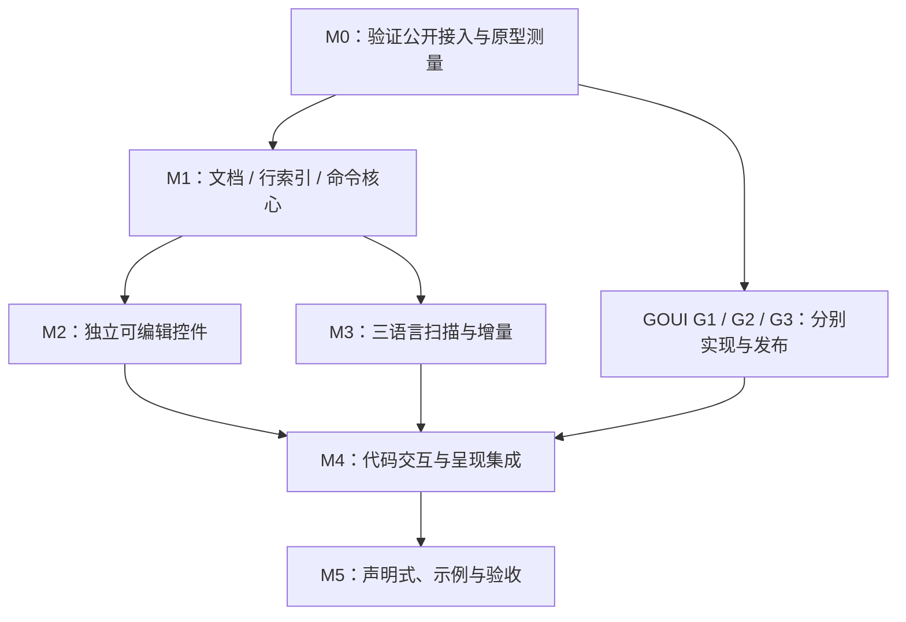

# SourceView 开发与验收计划

> 已有可运行的初始实现与双仓联调；尚未完成全平台原生验收及发布。
> 实际代码、命令、结果与限制见 [Implementation](Implementation.md)。
> 首版范围见 [总设计](DesignSourceView.md)，场景与目标见 [Testing](Testing.md)。
> 下列待办是开发切片，不构成未经用户授权就修改代码或其他仓库的许可。

## 1. 依赖与切片顺序

这是工作依赖图，不要求使用并行代理。GOUI 的每项扩展分别验证；
不把给 TextView 加装饰入口放在任何阶段。

## 2. M0：能力核验与风险原型

- [x] 以实际依赖版本核对 Widget、IME、Scrollable、typography 与 frame 的公开契约。
- [x] 用外部类型嵌入 WidgetBase 的最小原型验证焦点、输入、排版、滚动、快照及 mount/unmount。
- [x] 验证固定行号侧栏的坐标和 reveal 公式，不先引入自有滚动宿主。
- [ ] 验证顶部锚点恢复与宿主 ScrollIntoView/范围钳制的相容性。
- [x] 验证 AcceptsTab、只读及 Escape 后一次 Tab 放行确实进入 GOUI 默认焦点遍历。
- [ ] 测量常规与超长行 native shaping/命中开销，确认首版 profile 的风险边界。
- [x] 验证 token/选择前景变化的三端原生度量及 Geometry 复用条件；已测样本与边界见 [着色缓存验收](PlanColorCaching.md)。
- [ ] 为 G1/G2/G3 各自保留最小复现和接口评审说明，确认依赖版本策略。

产物：真实 API 使用证据、基线测量与具体扩展切片；原型资源放临时或专门验证位置，
不把私有 TextView 实现复制成正式起点。
退出：明确能直接使用的能力、阻塞验收的通用缺口和不可承诺的规模，不留下伪造 API。

## 3. GOUI 通用扩展

详细契约见 [DesignGOUIIntegration](DesignGOUIIntegration.md)。

| 项 | 阻塞的交付 | 独立验收 |
| --- | --- | --- |
| G1 ApplyBatch / 历史前后选区 | 多行缩进、反缩进、ReplaceAll 的一次撤销 | 原子性、UTF-8、通知/修订、历史与重入 |
| G2 typography TabWidth | 用户可配置 Tab 宽度 | 三后端度量、范围、命中、RTL/折行与默认兼容 |
| G3 Clipboard 结果 | 失败安全的 Cut 和可解释的读写错误 | 原生失败、空/无文本、同步回调、旧调用点迁移 |

- [x] 按 GOUI 的 AGENTS 分别实现并验证 G1/G2/G3，记录实际接口及拆分提交，不混入源码领域依赖。
- [x] 两仓本地 workspace 联调与 Windows/macOS 原生专项结果分别记录。
- [ ] 发布包含通用扩展和当前修正的可获取版本，更新依赖并通过 GOWORK=off 独立验证。

G 项没有完成前，相关 SourceView 功能可以开发或局部测试，但不能标记对应验收已通过。

## 4. M1：文档和编辑算法

- [x] 建模块、首批纯逻辑包和 testdata，保持实际可获取的 GOUI 依赖。
- [x] Document 对 Model 的组合、语言 epoch、挂载期订阅与复用策略。
- [x] lineStore 稳定身份、旧 byte 索引、按序 Change 映射和 Reset。
- [x] EditPlan、简单输入/删除、选区映射、历史分组与重入校验。
- [x] 基础缩进和线性字面量搜索计划；G1 未到位时先断言计划，不假装已原子提交。
- [x] 朴素参考与确定性随机编辑断言。

退出：纯逻辑测试不需要桌面；byte/line/选区/修订与独立预期一致，
跨行编辑不会让行索引和模型脱节。

## 5. M2：独立编辑 Widget

- [x] 叶子 SourceView、IMClient、Scrollable 与可见布局。
- [x] 普通文本排版、Geometry、HeightIndex、视口与 native cache。
- [x] 光标导航、鼠标选择、手势取消、焦点与挂载期资源。
- [ ] IME 投影、候选框、提交与取消；不依赖 TextView 输入控制器。
- [x] 剪贴板 pending 身份、基本 Undo/Redo、只读。
- [x] 语义快照包含有界可见原文和独立 preedit。

退出：无高亮的独立编辑器已可在真实窗口完成输入、选择、滚动和 IME；
逻辑回归、native 资源释放及首个桌面场景有记录。

## 6. M3：JSON / XML / HTML 与增量

- [x] 内置 language 元数据、Kind、三种独立扫描状态和 Scheme 映射。
- [x] 手写 token/状态样本、非法与不完整输入、分片边界。
- [x] 工作片段、预算、行末状态、dirty 区间与收敛。
- [x] 插删行对齐、语言切换、同文档多视图和 token LRU。
- [x] 冷定位 Plain 降级、任务代次、最后视图卸载停止驱动。
- [x] 三语言全部进入演示与编辑回归，HTML 不作为 XML 的别名交付。

退出：手写独立语义预期及增量对照通过；普通局部编辑不扫无关全文，
错误/未知区域不会破坏输入。

## 7. M4：完整首版集成

- [ ] G1/G2/G3 实际版本接入并运行专项回归。
- [ ] 行号、横向固定侧栏、折行、Tab、锚定与 reveal。
- [x] 多行缩进/反缩进、换行缩进、查找替换及一次撤销。
- [x] 亮暗、选区/搜索/当前行叠加、caret 与投影样式。
- [ ] 常规规模和极端样本，记录性能目标、资源峰值与残余限制。

退出：所有首版功能有对应测试与可观察结果；“暂缺通用扩展”的项目不能留作隐含已完成。

## 8. M5：声明式、示例与发布验证

- [x] 薄 WidgetView、稳定 Document、可选配置恢复与单份信号连接。
- [x] 挂载/卸载/文档替换时的 OnChange/OnSelection/OnError 正确管理。
- [x] 示例包含三种必需语言、可编辑与只读、行号、主题及查询。
- [x] tests/window 各主题入口注释与逐项预期。
- [ ] go test、相关 race、独立依赖与目标编译。
- [ ] Linux/Windows/macOS 关键输入、IME、Tab、剪贴板与缩放验收。
- [ ] 同步使用文档、已知限制及版本兼容；不把编译写成原生验收。

退出：能从设计链接找到 API、示例、测试与真实结果；发布所用依赖可获取。
某平台未验收时如实标注，不擅自改变三语言与可编辑的首版定位。

## 9. 实施状态说明

上面的勾选表示相关代码及已记录的验证已落地，不代表专题中的全部平台矩阵通过。
IME 投影、G1/G2/G3 三后端实现及顶部锚点已有代码；它们各自尚未完成的原生矩阵保持未勾选。
G1/G2/G3 尚未发布；独立依赖验证失败原因与后续门槛见 Implementation。

## 10. 设计交付

- [x] 明确独立控件、Document/视图所有权及公共 API 草案。
- [x] 细化命令、历史、IME、剪贴板、搜索及声明式绑定。
- [x] 细化三语言扫描、行身份、增量传播与预算。
- [x] 细化排版、Tab、滚动、固定侧栏、装饰与资源。
- [x] 记录已核对的 GOUI 源码及 G1/G2/G3 通用扩展提案。
- [x] 建立测试矩阵、初始性能目标及后续切片门槛。
- 文档检查结果在本轮交付说明中报告；以上勾选不表示任何实现或运行验收完成。

## 11. 着色缓存与度量稳定性（2026-10-16）

- [x] 先用回归复现配色/选区重建 native layout 和语言切换改写 LineID。
- [x] 分离着色状态与排版身份，完整覆盖旧前景；缓存初始索引转接、语言切换及重入资源释放。
- [x] 三端实际验证度量稳定、独立颜色预期位图、资源隔离与释放；DirectWrite 旧范围回收另在 GOUI 修正并复现前后差异。
- [x] Linux Software 1x/2x、OpenGL 1x 的正常焦点/选区重着色断言及原有编辑窗口断言通过。
- [x] 本机全仓/race/vet、远端全仓、目标编译及同环境前后计数/基准，见 [验收记录](PlanColorCaching.md)。
- [ ] 常规大文件、超长行 shaping、真实 IME 与跨屏矩阵仍按原计划推进；本切片不将这些目标标为通过。
