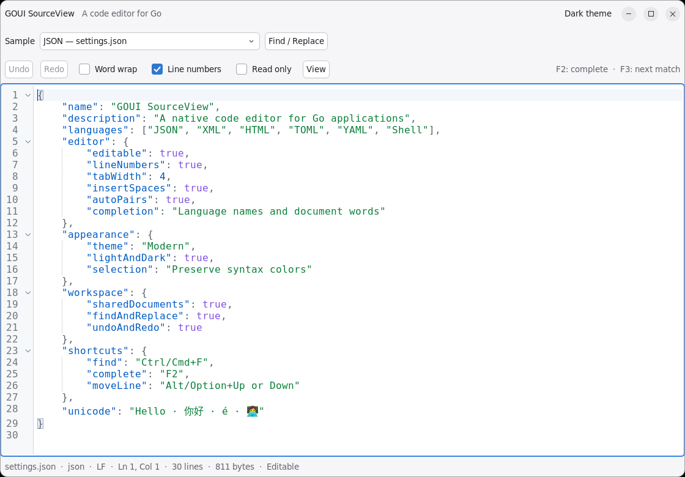
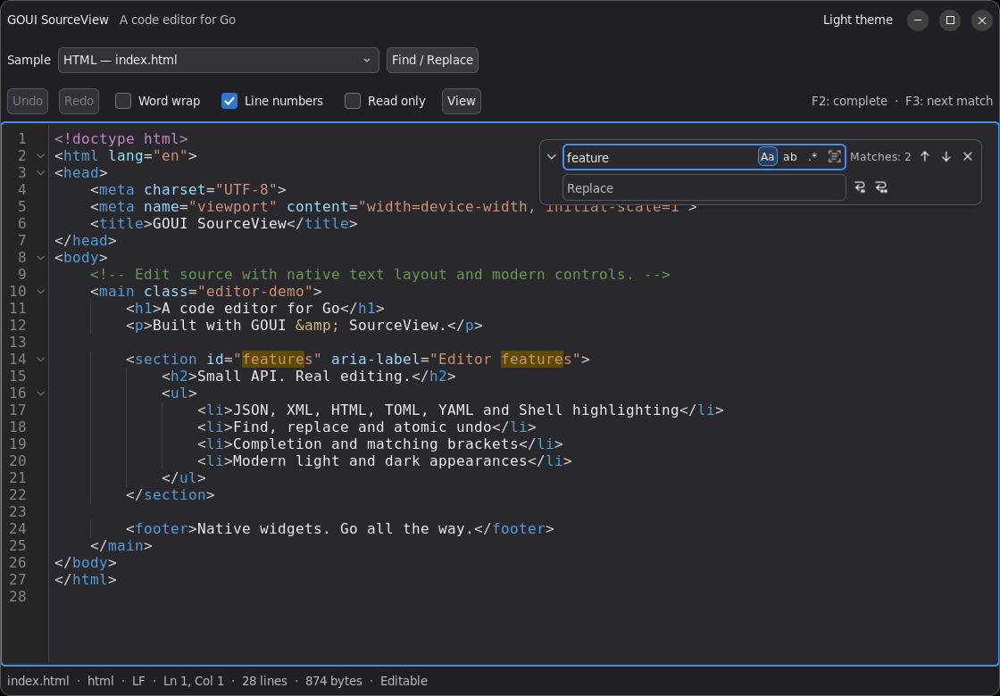

<h1 align="center">GOUI SourceView</h1>

<p align="center">面向 Go 桌面应用的原生代码编辑器</p>

<p align="center"><a href="../README.md">English</a></p>

GOUI SourceView 为 [GOUI](https://github.com/golang-gui/goui) 应用提供源码编辑能力，
支持语法高亮、补全、括号匹配及 Modern 亮暗外观，可通过命令式或声明式方式接入。

项目正在开发中。[v0.6.0](https://github.com/golang-gui/goui-sourceview/releases/tag/v0.6.0) 已发布，
变更与迁移方式见[发布说明](ReleaseV060.md)。

## 安装

需要 Go 1.24 或更新版本，以及由 Go 自动下载的 GOUI v0.8.0。
该正式版包含当前使用的类型化输入、Surface 和共享瞬态面接口，无需另行检出 GOUI
或创建双仓工作区即可构建本仓。版本与验证见[升级记录](PlanGOUIV080.md)。

安装 v0.6.0：

```sh
go get github.com/golang-gui/goui-sourceview/sourceview@v0.6.0
```

命令式 API 从子包导入：

```go
import source "github.com/golang-gui/goui-sourceview/sourceview"
```

`ui`、`language` 和 `scheme` 路径保持不变。从 v0.5.0 迁移时，将旧根包导入改为上述路径，
无需本地工作区。其他 API 变化见[发布说明](ReleaseV060.md)。

SourceView 独立维护正文、历史及段落缓存。直接使用 `Document`，不再使用
`Document.Model()`／`NewDocumentWithModel`；文本值使用 SourceView 的
`TextRange`、`TextSelection`、`TextEdit`、`TextChange`，声明式层提供同名别名。
详见[独立编辑内核](DesignEditorCore.md)。

## 主要能力

- **语法高亮：** 支持 JSON/JSONC、JSON Lines、XML、HTML、Markdown、TOML、YAML、Shell、HTTP、Protobuf、
  Makefile、CMake、Nginx、INI、Dockerfile、SQL、Go、Python、JavaScript、TypeScript、JSX、TSX、CSS、C、C++、Java、Rust、C#、Lua、PowerShell、Ruby、PHP、
  Kotlin、Swift、Dart、R、Zig、Objective-C、Objective-C++、Scala、Perl、Diff/Patch、Windows Batch、HCL/Terraform、GraphQL、SCSS、Less、Dotenv、Java Properties、Git Ignore/Attributes、Starlark、Groovy、
  Go Template、Jinja2、systemd unit、Desktop Entry、Nix、jq、PromQL、F#、Elixir、Erlang、Julia、Clojure、Haskell、OCaml、CSV、TSV、AsciiDoc、reStructuredText、TeX/LaTeX、BibTeX、gettext PO/POT、EditorConfig、JSON5、EDN、Git config、SSH config、crontab、Mermaid、Graphviz DOT，以及 Go 模块、工作区和校验文件。
- **混合文档：** Markdown 前置元数据和代码围栏高亮，以及 HTML、XML、YAML、TOML 模板宿主组合。
- **折叠与导航：** 结构化文档、常用代码语言、Markdown 标题及围栏折叠，支持独立外部折叠快照。
- **编辑辅助：** 智能缩进、空白标记、缩进线及列标尺。
- **多光标与列选择：** 可配置键鼠手势、匹配项命令及独立选区撤销。
- **保存点与视图状态：** 文档修改通知，以及同修订选区和视口恢复。
- **特殊字符：** 可选的原生 cluster 标记与 Unicode 说明提示。
- **源码编辑：** Unicode 与结构选区、子词导航、剪贴板、撤销/重做、重新缩进和整理命令。
- **行标记与地图：** 断点/书签呈现、执行行和色块 Minimap 导航。
- **外部分析：** 独立高亮/折叠快照及补全刷新。
- **影子建议：** 可选的宿主提供型单行/多行预览，支持 Tab 接受、Esc 取消及单步撤销。
- **补全与括号：** 补全建议、自动配对、匹配括号跳转及标签名称联动。
- **自定义语言：** 由应用配置高亮、编辑规则及补全。
- **查找替换：** 浮动面板，支持多行、正则、捕获组替换及选区内搜索。
- **亮暗外观：** 选中文本时保留语法颜色。
- **多语言界面：** 编辑菜单及查找替换支持八种语言。

## 界面预览

Modern 浅色 — JSON



Modern 深色 — HTML



截图来自 Linux 上实际运行的示例程序。

## 使用 AI 编写编辑器

[SourceView 应用开发 Skill](../skills/goui-sourceview-app/SKILL.md) 帮助你的 AI 接入编辑器，
并定制语法高亮、编辑规则和补全。只需告诉 AI：

> 请按照 https://github.com/golang-gui/goui-sourceview/blob/main/skills/INSTALL.md 的说明，安装 SourceView 应用开发 Skill。

AI 会按[安装说明](../skills/INSTALL.md)使用当前工具的原生技能机制完成安装。
不支持 Skill 的工具可直接阅读开发指南。安装技能不会安装或升级应用的 Go 依赖。

## 体验示例

需要 Go 1.24 或更新版本。先按[示例指南](../example/README.md) 准备开发环境，
再在仓库根目录运行：

```sh
go run ./example/editor
```

示例包含所有内置语言的可编辑样本，可以体验查找与补全，并切换亮暗外观。
另提供[声明式示例](../example/declarative)和[自定义 Markdown 编辑器](../example/markdown)。

## 许可证

[MIT](../LICENSE)
